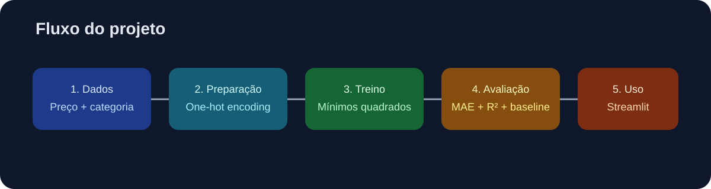

# Projeto 5 — Previsão de vendas com Machine Learning

Aplicação educacional que estima a quantidade vendida de um produto a partir do preço e da categoria. O projeto demonstra o fluxo básico de Machine Learning: preparação dos dados, codificação de categorias, treino, avaliação e uso do modelo em uma pequena interface interativa.

## Demonstração

🌐 **Aplicação publicada:** será adicionada após o deploy no Streamlit Community Cloud.



## O que foi praticado

- leitura e preparação de dados tabulares com Pandas;
- transformação de categorias em variáveis numéricas com one-hot encoding;
- regressão linear treinada com mínimos quadrados usando NumPy;
- separação simples entre treino e teste;
- avaliação com MAE, MAE de baseline e R²;
- criação de uma interface de previsão com Streamlit;
- testes automatizados para treino e inferência.

## Como executar localmente

```bash
python -m venv .venv
# Windows PowerShell
.venv\Scripts\Activate.ps1
pip install -r requirements.txt
python model.py
python -m streamlit run app.py
```

Para executar os testes:

```bash
python -m pytest -q
```

## Como o modelo funciona

O modelo usa três partes de entrada: um intercepto, o preço e uma coluna binária para cada categoria. A previsão pode ser representada de forma simplificada por:

```text
quantidade_estimada = intercepto + (coeficiente_preço × preço) + efeito_da_categoria
```

Os resultados atuais no conjunto de teste são:

| Métrica | Resultado |
|---|---:|
| MAE do modelo | 19,46 |
| MAE do baseline | 22,00 |
| R² | -0,01 |

O modelo reduz o erro absoluto médio em relação ao baseline, mas o R² próximo de zero mostra que este conjunto pequeno não sustenta um modelo preditivo forte. Essa limitação faz parte do aprendizado: antes de usar um modelo em produção, seria necessário reunir mais dados, validar a divisão temporal e comparar outras abordagens.

## Estrutura

```text
05-machine-learning/
├── app.py                 # interface Streamlit
├── model.py               # treino, métricas e previsão
├── data/products.csv      # dados didáticos
├── outputs/metrics.json   # última avaliação registrada
├── tests/test_model.py    # testes automatizados
└── docs/images/           # imagem explicativa do fluxo
```

## Próximos aprimoramentos

1. aumentar o histórico de vendas;
2. incluir data, sazonalidade e estoque como variáveis;
3. usar validação temporal;
4. comparar regressão, árvore de decisão e modelos de ensemble;
5. monitorar erro e mudança na distribuição dos dados.

## Contexto acadêmico

Este projeto integra a trilha prática de Python, Pandas e Machine Learning da disciplina de Engenharia de Software. O objetivo é demonstrar entendimento do processo e capacidade de transformar um conceito em uma aplicação reproduzível.
